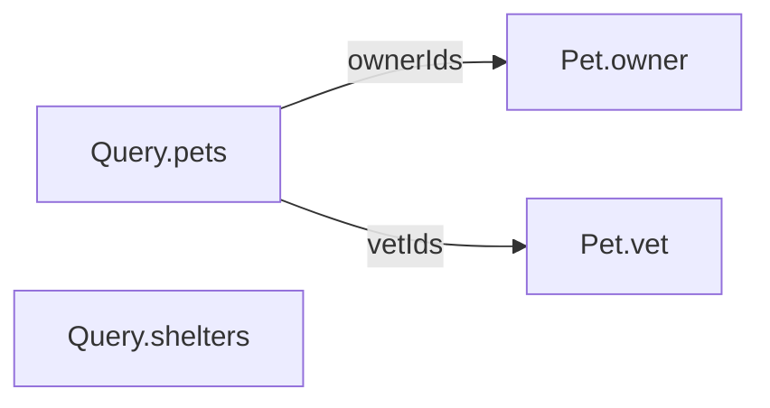
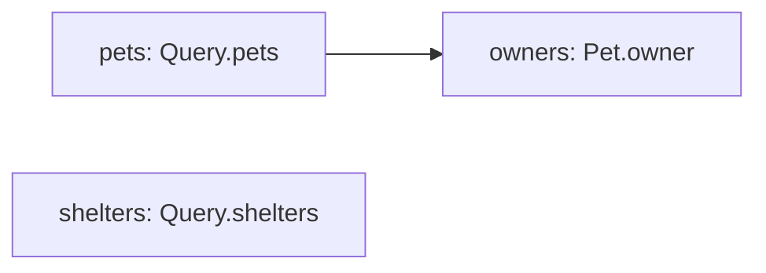

# Torpor

Contract-first, type-safe GraphQL library for Scala 3.

You write the schema as SDL, and the compiler checks it. Each extension field takes a batch of keys, so a query makes one call for each node, not one call for each row. When a backend is slow, a durable run stops, keeps its state in a store, and continues when the work is done, days later if necessary. Torpor is built on cats-effect and [hedgehogs](https://github.com/andimiller/hedgehogs).

## Contents

- [Key Concepts](#key-concepts)
- [Getting Started - Server](#getting-started---server)
    - [1. Add the dependencies](#1-add-the-dependencies)
    - [2. Write the schema](#2-write-the-schema)
    - [3. Write the sources](#3-write-the-sources)
    - [4. Serve the schema](#4-serve-the-schema)
    - [5. Write the golden file](#5-write-the-golden-file)
    - [6. Look at the generated schema](#6-look-at-the-generated-schema)
    - [7. Explain a plan](#7-explain-a-plan)
- [Getting Started - Client](#getting-started---client)
    - [1. Add the dependency](#1-add-the-dependency)
    - [2. Copy the schema](#2-copy-the-schema)
    - [3. Bind the schema to your types](#3-bind-the-schema-to-your-types)
    - [4. Write an operation](#4-write-an-operation)
    - [5. Make the client and run the operation](#5-make-the-client-and-run-the-operation)
    - [6. Give variables](#6-give-variables)
    - [7. Read unions, optional fields and enums](#7-read-unions-optional-fields-and-enums)
    - [8. See what does not compile](#8-see-what-does-not-compile)
- [Examples](#examples)
- [Status](#status)
- [What Torpor is not](#what-torpor-is-not)
- [Modules](#modules)
- [Build](#build)
- [Glossary](#glossary)

## Key Concepts

### The schema is the contract

Define your schema via SDL text directly in your source code. The compiler validates each SDL fragment and turns it into types that your resolvers work with directly. Schemas are parsed, validated and types generated at compile time without any code generation. The same SDL is the contract with your clients: a test writes the merged schema to a golden file, and each client checks its operations against that file when it compiles. Your Scala types do not know about GraphQL. In a code-first library, the schema is the graph of resolvers, so a type gets an effect field each time a value becomes lazy.

```scala
// Define a new schema fragment
val pets = schema"""
  extend type Query { # Make a root 'pets' field
    pets: [Pet!]!     # available to query
  }
  type Pet {      # Define the new type 'Pet', with
    id: ID!       # fields 'id' and 'name'
    name: String!
  }
  """
```

### Sources implement the schema with Resolvers

A source combines an SDL fragment with its backend implementation. Torpor calls that resolver only when a query selects the field, making hydration lazy.

```scala
// Our Scala type for a pet. 'ownerId' is not in the SDL: it is the key for the owner
final case class Pet(id: String, name: String, ownerId: String) derives Encoder.AsObject, Decoder

// Our backend which can get the list of pets
trait PetStore[F[_]] {
  def loadAll: F[List[Pet]]
}
val petStore = PetStore.impl[IO](...)

// Add a Source for the 'pets' schema
val petsSource =
  Source[IO](
    id = "pets", // A unique name for the source
    sdl = pets)( // Points to the SDL we defined
      resolver.root[IO]( // A resolver matching a root field
        pets.Query.pets  // The SDL field, presented by Torpor as a typed value
      )(_ => petStore.loadAll) // Wire the query to our backend implementation
  )
```

### Sources can be composed, with built-in batching

Multiple sources can be combined into a single schema. Sources can add extra fields to already-declared types via `extend type`. Resolvers for extension fields are the key to batching - allowing all values to be retried at the same time once the parent is. When you compose the sources, the compiler checks that every extension has exactly one resolver, and that each key function reads the Scala type that another source makes. At startup, Torpor merges the fragments and checks the merged schema. A batch function takes a `NonEmptyList` of keys and returns a `Map`. There is no form that takes one key, so an N+1 query cannot occur.

```scala
// Define a second fragment, which adds a field to 'Pet'
val owners = schema"""
  type Owner {        # Define the new type 'Owner'
    name: String!
  }
  extend type Pet {   # Add a field to 'Pet', which
    owner: Owner      # the 'pets' source declares
  }
  """

// Our backend which can get many owners in one call
trait OwnerStore[F[_]] {
  def loadByIds(ids: NonEmptyList[String]): F[Map[String, Owner]]
}
val ownerStore = OwnerStore.impl[IO](...)

// Add a Source for the 'owners' schema
val ownersSource =
  Source[IO](
    id = "owners", // A unique name for the source
    sdl = owners)( // Points to the SDL we defined
      resolver
        .field[IO](  // A resolver for a field added to another type
          owners.Pet.owner   // The extra SDL field added by our extension
      )
      .key(
        (pet: Pet) => // The pet as resolved by our original `petsSource`
          pet.ownerId // The field used to find the owner
      )
      .batch(
        (_, ownerIds) => // The owner IDs, all batched together
          ownerStore.loadByIds(ownerIds) // How to find the owner in our backend
      )
  )

// Compose both sources, with compiler checking that dependencies between them are satisfied
val torpor =
  Torpor[IO](petsSource, ownersSource)
```

### A plan is data

Torpor generates plans as a graph of dependencies. At query time, Torpor validates the request, generates a plan, and then executes it. Plans are optimised for parallelism and batching; non-dependent nodes in the plan are run concurrently, and dependent nodes apply batching. Plans can be inspected with `Explain`, and are durable to allow for long-running requests. A plan is plain data: the executor runs it, a durable run stores it, and Explain draws it. What you inspect is what runs.

For example, this query:

```graphql
{
  pets { owner { name } vet { name } }
  shelters { name }
}
```

has a plan with four nodes:



- `Query.pets` and `Query.shelters` may start at the same time.
- `Pet.owner` and `Pet.vet` need ids from `Query.pets`. These start when `Query.pets` is resolved, and they run at the same time.

### A run can outlive the request

A resolver can stop the whole run with `Step.suspend(handle)`. Torpor then keeps the plan, the finished nodes and the handles in a `SnapshotStore`, in memory or in Postgres. Later, a webhook resumes the run, in a different process if necessary. The store uses compare-and-swap, so when two webhooks try to resume the same run, only one of them runs it. You do not need a workflow engine.

### Errors are values

Failed resolvers do not cause a whole query to fail, instead returning partial failures, with an error at the path of each field that the resolver could not serve.

## Getting Started - Server

This guide makes a small pet shop server from the two sources in Key Concepts, and a third source for shelters. It serves the schema over HTTP, writes the schema to a golden file, and prints the plan for a query.

Torpor needs Scala 3.3 or later, cats-effect 3, circe 0.14 and http4s 0.23. In the samples, replace `@VERSION@` with the Torpor release that you use.

### 1. Add the dependencies

```scala
libraryDependencies ++= Seq(
  "net.andimiller" %% "torpor-source"       % "@VERSION@",
  "net.andimiller" %% "torpor-macros"       % "@VERSION@",
  "net.andimiller" %% "torpor-http"         % "@VERSION@",
  "net.andimiller" %% "torpor-explain"      % "@VERSION@",
  "org.http4s"     %% "http4s-ember-server" % "0.23.30",            // or a different http4s server
  "net.andimiller" %% "torpor-testkit"      % "@VERSION@" % Test
)
```

### 2. Write the schema

Put the fragments in an object, so that the server and the golden test in step 5 can both use them.

```scala
import net.andimiller.torpor.macros.schema

// The schema: one fragment for each source
object PetshopSchema {
  val pets = schema"""
    extend type Query { # Make a root 'pets' field
      pets: [Pet!]!     # available to query
    }
    type Pet {          # Define the new type 'Pet', with
      id: ID!           # fields 'id' and 'name'
      name: String!
    }
    """

  val owners = schema"""
    type Owner {        # Define the new type 'Owner'
      name: String!
    }
    extend type Pet {   # Add a field to 'Pet', which
      owner: Owner      # the 'pets' source declares
    }
    """

  val shelters = schema"""
    extend type Query {     # Make a root 'shelters' field
      shelters: [Shelter!]! # available to query
    }
    type Shelter {          # Define the new type 'Shelter'
      name: String!
    }
    """
}
```

### 3. Write the sources

This step uses backends that keep their data in memory. In your service, they call your databases or other services.

```scala
import cats.data.NonEmptyList
import cats.effect.IO
import io.circe.{Decoder, Encoder}
import net.andimiller.torpor.source.*

// Our Scala types. 'ownerId' is not in the SDL: it is the key for the owner
final case class Pet(id: String, name: String, ownerId: String) derives Encoder.AsObject, Decoder
final case class Owner(name: String) derives Encoder.AsObject
final case class Shelter(name: String) derives Encoder.AsObject

// Our backends
trait PetStore[F[_]] {
  def loadAll: F[List[Pet]]
}
trait OwnerStore[F[_]] {
  def loadByIds(ids: NonEmptyList[String]): F[Map[String, Owner]]
}
trait ShelterStore[F[_]] {
  def loadAll: F[List[Shelter]]
}

// In-memory backends for this example
val petStore = new PetStore[IO] {
  def loadAll: IO[List[Pet]] =
    IO.pure(List(Pet("1", "Rex", "alice"), Pet("2", "Tom", "bob"), Pet("3", "Fido", "alice")))
}
val ownerStore = new OwnerStore[IO] {
  private val owners = Map("alice" -> Owner("Alice"), "bob" -> Owner("Bob"))
  def loadByIds(ids: NonEmptyList[String]): IO[Map[String, Owner]] =
    IO.pure(ids.toList.flatMap(id => owners.get(id).map(id -> _)).toMap)
}
val shelterStore = new ShelterStore[IO] {
  def loadAll: IO[List[Shelter]] =
    IO.pure(List(Shelter("Northside Rescue"), Shelter("Harbour Animal Home")))
}

// A Source for the 'pets' fragment
val petsSource =
  Source[IO](
    id = "pets",              // A unique name for the source
    sdl = PetshopSchema.pets  // Points to the SDL we defined
  )(
    resolver.root[IO](              // A resolver matching a root field
      PetshopSchema.pets.Query.pets // The SDL field, presented by Torpor as a typed value
    )(_ => petStore.loadAll)        // Wire the query to our backend
  )

// A Source for the 'owners' fragment
val ownersSource =
  Source[IO](
    id = "owners",              // A unique name for the source
    sdl = PetshopSchema.owners  // Points to the SDL we defined
  )(
    resolver
      .field[IO](                      // A resolver for a field added to another type
        PetshopSchema.owners.Pet.owner // The extra SDL field added by our extension
      )
      .key(
        (pet: Pet) =>   // The pet as resolved by the 'pets' source
          pet.ownerId   // The field used to find the owner
      )
      .batch(
        (_, ownerIds) =>                  // The owner ids, all batched together
          ownerStore.loadByIds(ownerIds)  // How to find the owners in our backend
      )
  )

// A Source for the 'shelters' fragment
val sheltersSource =
  Source[IO](
    id = "shelters",              // A unique name for the source
    sdl = PetshopSchema.shelters  // Points to the SDL we defined
  )(
    resolver.root[IO](                      // A resolver matching a root field
      PetshopSchema.shelters.Query.shelters // The SDL field, presented by Torpor as a typed value
    )(_ => shelterStore.loadAll)            // Wire the query to our backend
  )
```

### 4. Serve the schema

```scala
import cats.effect.{IO, IOApp}
import com.comcast.ip4s.*
import net.andimiller.torpor.http.TorporHttp
import org.http4s.ember.server.EmberServerBuilder
import org.http4s.implicits.*

object PetshopServer extends IOApp.Simple {
  def run: IO[Unit] =
    Torpor[IO](petsSource, ownersSource, sheltersSource) // Compose the sources: the compiler checks their wiring
      .startup                           // Merge the fragments and check the merged schema
      .flatMap { case (torpor, schema) =>
        EmberServerBuilder
          .default[IO]
          .withPort(port"8080")
          .withHttpApp(TorporHttp.routes(torpor, schema).orNotFound) // Serve POST /graphql
          .build
          .useForever
      }
}
```

Run `PetshopServer`, then send a query:

```bash
curl -s localhost:8080/graphql \
  -H 'Content-Type: application/json' \
  -d '{"query": "{ pets { name owner { name } } shelters { name } }"}'
```

The response, formatted:

```json
{
  "data": {
    "pets": [
      { "name": "Rex",  "owner": { "name": "Alice" } },
      { "name": "Tom",  "owner": { "name": "Bob" } },
      { "name": "Fido", "owner": { "name": "Alice" } }
    ],
    "shelters": [
      { "name": "Northside Rescue" },
      { "name": "Harbour Animal Home" }
    ]
  }
}
```

Torpor makes three calls for this query: one to the pets `loadAll`, one to the shelters `loadAll`, and one to `loadByIds` with the ids `alice` and `bob`. Rex and Fido have the same owner, so Torpor sends `alice` one time only. The query `{ pets { name } }` makes one call only, because it does not select `owner` or `shelters`.

### 5. Write the golden file

Add a test that writes the merged schema to a file:

```scala
import java.nio.file.Paths
import net.andimiller.torpor.core.Sdl
import net.andimiller.torpor.testkit.GoldenGraphqlsTest

final class PetshopSchemaTest extends GoldenGraphqlsTest {
  def schemas: List[Sdl[?]] = List(PetshopSchema.pets, PetshopSchema.owners, PetshopSchema.shelters) // The fragments to merge
  override def golden       = Paths.get("src/test/resources/petshop.graphqls") // Where to write them
}
```

If the file does not exist, the test writes it. Review the file and commit it. After that, the test fails with a diff when the schema changes.

### 6. Look at the generated schema

The first run of the test writes this file:

```graphql
type Owner {
  name: String!
}

type Pet {
  id: ID!
  name: String!
  owner: Owner
}

type Query {
  pets: [Pet!]!
  shelters: [Shelter!]!
}

type Shelter {
  name: String!
}
```

The file has no `extend type`. Torpor merges each extension into the type that it extends, and makes the `Query` type because no fragment declares it. The `#` comments are not in the file. This file is the contract that you give to the teams that call your server.

### 7. Explain a plan

`Explain` prints the plan for a query, but does not run it. Use it to see the calls that a query will make.

```scala
import cats.effect.IO
import net.andimiller.torpor.explain.Explain
import net.andimiller.torpor.schema.{Executable, Schema}
import net.andimiller.torpor.source.Planner

// Print the plan for a query, without running it
def explain(schema: Schema, query: String): String = {
  val explained = for {
    validated <- Executable.validate(schema, query)              // Check the query against the schema
                   .left.map(_.toChain.toList.map(_.render))
    plan      <- Planner.build(schema, validated)                // Make the plan
                   .left.map(_.toChain.toList.map(_.render))
  } yield Explain.mermaid(plan) + "\n\n" + Explain.report(plan)  // Draw it, and count its calls
  explained.fold(_.mkString("\n"), identity)
}

// Explain a query against the merged schema
Torpor[IO](petsSource, ownersSource, sheltersSource).startup.map { case (_, schema) =>
  println(explain(schema, "{ pets { name owner { name } } shelters { name } }"))
}
```

It prints:

```text
flowchart LR
  n0["pets: Query.pets"]
  n1["owners: Pet.owner"]
  n2["shelters: Query.shelters"]
  n0 --> n1

depth 3, 6 fields, 3 calls over 2 level(s)
level 1: pets x1 (Query.pets); shelters x1 (Query.shelters)
level 2: owners x1 (Pet.owner)
```

The first part is a Mermaid flowchart, with one node for each batch call:



`Query.shelters` has no edge: it needs no keys from another node, so it runs at the same time as `Query.pets`. `Pet.owner` needs the owner ids from `Query.pets`, so it starts when `Query.pets` is done.

The report gives the depth of the query, the number of fields it selects, and the number of calls. Then it gives one line for each level: the sources at that level, their number of calls, and their fields.

## Getting Started - Client

This guide calls a pet shop API from a Scala service with `torpor-client`. You write each operation one time, as GraphQL. When your code compiles, the client checks the operation against the schema, and makes the type of its response from the fields that it selects. Thus there are no case classes to keep in step with the operation, and the client does not generate code.

The client needs only the schema. The server does not have to be a Torpor server.

The client needs Scala 3.3 or later, cats-effect 3, circe 0.14 and http4s 0.23. In the samples, replace `@VERSION@` with the Torpor release that you use.

### 1. Add the dependency

```scala
libraryDependencies += "net.andimiller" %% "torpor-client" % "@VERSION@"
```

### 2. Copy the schema

`Api.sdl` takes the schema as a string that the compiler can read: a literal, or an `inline val`. Copy the schema that the server serves into a Scala object, such as from the golden file that the server's test writes (step 5 of [Getting Started - Server](#getting-started---server)). When the server's schema changes, change the object too. The compiler then checks again each operation that uses the schema.

```scala
// The schema that the server serves, as a constant
object PetshopSchema {
  inline val sdl = """
    enum Species { DOG CAT }
    type Pet { id: ID! name: String! species: Species! age: Int owner: Owner }
    type Owner { name: String! pets: [Pet!]! }
    type Shelter { name: String! capacity: Int! }
    union Home = Owner | Shelter
    input PetFilter { species: Species! minAge: Int }
    type Query {
      pets(species: Species, first: Int): [Pet!]!
      search(filter: PetFilter!): [Pet!]!
      home(pet: ID!): Home
    }
  """
}
```

### 3. Bind the schema to your types

Make the `Api` one time. Tell it which Scala type to read a leaf as: for one field, or for all the fields of a type. If you do not, an `ID` is a `String` and an `Int` is an `Int`. The compiler parses the schema one time, for all the operations that use it.

```scala
import cats.effect.IO
import io.circe.Decoder
import net.andimiller.torpor.client.{Api, GraphQLClient, input}
import org.http4s.client.Client
import org.http4s.implicits.*

final case class PetId(value: String)
given Decoder[PetId] = Decoder.decodeString.map(PetId(_)) // How to read a PetId from the response

val petshop = Api
  .sdl(PetshopSchema.sdl) // The schema from step 2
  .read["Pet.id", PetId]  // Read the field 'Pet.id' as a PetId
  .read["Int", Long]      // Read every field of type 'Int' as a Long
```

The schema and the leaf types are part of the type of the `Api` value. Thus you do not need other imports where you write an operation, and a formatter cannot remove an import as unused.

### 4. Write an operation

An operation compiles only if the document is valid against the schema. The compiler makes its response type from the fields that it selects.

```scala
val pets = petshop.operation(
  """
    query Pets($species: Species, $first: Int) { # Declare the variables
      pets(species: $species, first: $first) {   # Select the root 'pets' field
        id                                       # A PetId, from step 3
        name                                     # A String
        age                                      # An Option[Long]: 'age' can be null
        owner { name }                           # An Option of a record with a 'name'
      }
    }
  """
)
```

An operation can be any string that the compiler can read: a literal, or literals and `inline val`s put together with `s"…"`. Thus operations can share a selection:

```scala
inline val petFields = "id name age owner { name }" // A selection to share

val everyPet = petshop.operation(
  s"""
    query EveryPet {
      pets { $petFields }
    }
  """
)
```

### 5. Make the client and run the operation

The client takes an http4s `Client`, which adds headers, authentication and tracing, as for any other service. Give the variables by name, and read the response by field.

If the response has errors, `run` fails with a `GraphQLFailure`, which has the message and the path of each error. If the response is not a GraphQL response, `run` fails with the http4s `UnexpectedStatus`.

```scala
def client(http: Client[IO]): GraphQLClient[IO] =
  new GraphQLClient[IO](http, uri"https://pets.example/graphql") // The URL of the GraphQL endpoint

def names(client: GraphQLClient[IO]): IO[List[(PetId, String, Option[Long])]] =
  client
    .run(pets(first = 2))                                // Give the variables by name
    .map(_.pets.map(pet => (pet.id, pet.name, pet.age))) // Read the response by field
```

### 6. Give variables

The compiler checks each variable against the one that the document declares. You can omit a variable that can be null or that has a default, such as `species` above. An enum variable takes one of its values as a literal.

A variable that you give as `None` is not sent, so the server uses the default of the variable. A variable that you give as `null` is sent as null.

```scala
val dogs      = pets(species = "DOG") // An enum value, as a literal
val unlimited = pets(first = None)    // 'first' is not sent
val nullFirst = pets(first = null)    // 'first' is sent as null
```

Write an input object with `input(…)`. The compiler checks it against the input type where you give it. You can omit a field that can be null.

```scala
val search = petshop.operation("query Search($filter: PetFilter!) { search(filter: $filter) { name } }")

val oldDogs = search(filter = input(species = "DOG", minAge = 10)) // A PetFilter
val anyCats = search(filter = input(species = "CAT"))              // 'minAge' is not sent
```

### 7. Read unions, optional fields and enums

The response can omit a field that only some types select in a fragment, or a field behind `@skip` or `@include`. Thus that field is an `Option`. With `@include`, you ask for part of a response only when you need it.

The `__typename` of a union or an interface is the union of the names of its types. If the document selects `__typename`, the response also has a view for each type, such as `asShelter`. A view is `Some` only when the server sent that type. In a view, a field of that type is an `Option` only if it can be null or is behind `@skip` or `@include`.

```scala
val home = petshop.operation(
  """
    query Home($id: ID!, $withCapacity: Boolean!) {
      home(pet: $id) {                                                # 'Home' is the union Owner | Shelter
        __typename                                                    # "Owner" | "Shelter"
        ... on Owner { name }                                         # Every member selects 'name'
        ... on Shelter { name capacity @include(if: $withCapacity) }  # Only a Shelter has 'capacity'
      }
    }
  """
)

def capacity(client: GraphQLClient[IO], id: String): IO[Option[Long]] =
  client
    .run(
      home(
        id = id,
        withCapacity = true
      )
    )
    .map(_.home.flatMap(_.asShelter).flatMap(_.capacity))
```

Every member of the union selects `name`, so `name` is a `String`. Only a `Shelter` selects `capacity`, so `capacity` is an `Option`. In the view `asShelter`, `capacity` is still an `Option`, because it is behind `@include`.

An enum is a union of its values as string literals, such as `"DOG" | "CAT"`, unless the `Api` binds it to a type of your own with `read`.

### 8. See what does not compile

The compiler rejects an operation or a call that does not fit the schema, and tells you why:

```scala
val withNickname = petshop.operation("{ pets { id nickname } }")  // 'Pet' has no field 'nickname'
def speciesOf(data: pets.Data) = data.pets.map(_.species)         // 'pets' does not select 'species'
// error:
// the operation does not fit the schema:
//   query:1:13: 5.3.1 Field Selections: type 'Pet' has no field 'nickname'
// val withNickname = petshop.operation("{ pets { id nickname } }")  // 'Pet' has no field 'nickname'
//                    ^^^^^^^^^^^^^^^^^^^^^^^^^^^^^^^^^^^^^^^^^^^^^
// error:
// value species is not a member of net.andimiller.torpor.client.Record{
//   val id: MdocApp0.this.PetId; val name: String; val age: Option[Long];
//     val owner: Option[net.andimiller.torpor.client.Record{val name: String}]
// }
// def speciesOf(data: pets.Data) = data.pets.map(_.species)         // 'pets' does not select 'species'
//                                                ^^^^^^^^^
```

The compiler checks each variable, and each field of an input object:

```scala
val birds     = pets(species = "BIRD")                                     // 'BIRD' is not a Species
val twoPets   = pets(first = "two")                                        // 'first' is an Int
val brownDogs = search(filter = input(species = "DOG", colour = "brown"))  // PetFilter has no field 'colour'
val noSpecies = search(filter = input(minAge = 10))                        // 'species' is required
// error:
// the variables do not fit the operation:
//   $species is the enum Species in the schema, but "BIRD" is not one of its values: DOG, CAT
// val birds     = pets(species = "BIRD")                                     // 'BIRD' is not a Species
//                 ^^^^^^^^^^^^^^^^^^^^^
// error:
// the variables do not fit the operation:
//   $first is a Int in the schema, so it is written as BigInt or Int or Long, not String
// val twoPets   = pets(first = "two")                                        // 'first' is an Int
//                 ^^^^^^^^^^^^^^^^^^
// error:
// the variables do not fit the operation:
//   $filter has a field 'colour', which the input type PetFilter does not have
// val brownDogs = search(filter = input(species = "DOG", colour = "brown"))  // PetFilter has no field 'colour'
//                 ^^^^^^^^^^^^^^^^^^^^^^^^^^^^^^^^^^^^^^^^^^^^^^^^^^^^^^^^
// error:
// the variables do not fit the operation:
//   $filter.species must be given a value
// val noSpecies = search(filter = input(minAge = 10))                        // 'species' is required
//                 ^^^^^^^^^^^^^^^^^^^^^^^^^^^^^^^^^^
```

## Examples

The repository has two complete services. Both serve ESI, the public API of EVE Online.

| Example | Contents |
| --- | --- |
| [`examples/esi`](examples/esi) | A Torpor server with three sources, lazy hydration, a route that fans out over many levels, a `POST /explain` route, and tests that count the calls of each query |
| [`examples/esi-caliban`](examples/esi-caliban) | The same service, written with Caliban. Compare it with `examples/esi` to see the differences between the two libraries. Its tests count the calls of each query, which shows why the batch signature matters. |

## Status

These features work now:

| Feature | What works |
| --- | --- |
| SDL | A fragment for each source, `extend type` across sources, and merge errors with `source:line:column` |
| Compile-time checks | `schema"""…"""` validates a fragment and gives its field values. A field that the SDL does not declare does not compile. When you compose sources, the compiler checks that each source resolves exactly the fields that its SDL requires, and that each key function reads a type that another source makes. |
| Validation | A documented subset of the rules of the specification. A construct that Torpor does not support fails with an error. |
| Planner | A query becomes a graph of batch calls. Variables become literals, SDL defaults are filled in, and input values are coerced. |
| Batched arguments | The arguments of each field are typed from the SDL, and come to the batch function one time for each set of arguments |
| Unions and interfaces | Fragments with type conditions, and `__typename` in all positions. A resolver gives the member type with `resolver.tagged`, or with its own `__typename`. |
| Null bubbling | A null in a non-null field moves up to the nearest nullable parent. The error keeps the path of the field. |
| Executor | One call for each node. A node starts when the node that gives its keys is done. Errors are values, with response paths. |
| Hooks | `Hooks[F]`: a span and timing for each node, a slow-query log, authorization for each batch, and one error mapper |
| Limits | `maxDepth` and `maxFields` |
| Durable runs | Suspend and resume, with a `SnapshotStore` in memory or in Postgres |
| HTTP | `POST /graphql`, with GraphQL errors as status 200, and a setup function for each request |
| Tools | Introspection, `Explain.mermaid` and `Explain.report` |
| Relay | `torpor-relay`: `Connection[A]`, `PageInfo` and `PageArgs` |
| Client | `torpor-client`: an operation compiles only if it is valid against the schema, and `Api` makes its response type from the document. Variables are given by name and checked against the schema. Enums are unions of literals. `GraphQLClient` runs an operation over http4s. |

These features are not built yet:

- `@defer`, `@stream`, SSE, and an HTTP endpoint to resume a durable run. You resume a run from your own code only.
- Subscriptions. Extension fields that suspend. Timeouts for each node, cost metrics, and a cache across levels.
- The full coercion of values for custom scalars. The `Decoder` of the `Scalar` binding decodes the input.
- Integration tests for the Postgres store. The compare-and-swap contract is tested against the in-memory store.
- Scala 2.13. A Scala 2.13 service uses Torpor over HTTP.

## What Torpor is not

- **Not a federation gateway.** Sources are modules in your process, not remote GraphQL services.
- **Not a SQL engine.** If your data is relational and the shape of the query is important, use [Grackle](https://github.com/typelevel/grackle).
- **Not only for one effect type.** `Torpor[F]` works for any `F[_]: Concurrent`.
- **Not a code generator.** `torpor-client` checks the operations that you write against a schema file, and the compiler makes their types. It does not generate code. [Caliban](https://github.com/ghostdogpr/caliban) generates code.
- **Not complete.** [docs/roadmap.md](docs/roadmap.md) tells what comes next.

## Modules

| Module | Contents |
| --- | --- |
| `torpor-core` | Plan data, the `Resolver` interface, the executor, and response assembly |
| `torpor-schema` | SDL merge, validation, executable documents, and introspection |
| `torpor-macros` | `schema"""…"""` and `sdl"""…"""` |
| `torpor-source` | The planner, the resolver DSL, `Torpor`, and `Durable` |
| `torpor-snapshot` | Snapshot codecs, and `SnapshotStore` in memory and in Postgres (skunk) |
| `torpor-explain` | The Mermaid plan and the report of calls for each level |
| `torpor-relay` | Relay `Connection` and `PageInfo` slicing |
| `torpor-http` | The http4s route, and the setup function for each request |
| `torpor-client` | Operations that the compiler checks against a schema file, and an http4s client that runs them |
| `torpor-testkit` | The golden test for the merged schema |

Only `torpor-schema` uses Sangria, for the parser.

## Build

```bash
sbt test
```

Torpor builds with Scala 3.3 LTS on the JVM.

## Glossary

This documentation uses each term below with one meaning only.

| Term | Meaning |
| --- | --- |
| schema | The SDL that defines the types and fields that clients can query |
| fragment | One part of the schema, written as SDL in `schema"""…"""` |
| source | A fragment and the resolvers for the fields that it must resolve, with a unique `id` |
| resolver | The function that gets the values of a field from your backend |
| root field | A field of `Query` or `Mutation`. Its resolver gets the arguments of the field. |
| extension field | A field that a source adds to a type with `extend type`. Its resolver gets a batch of keys. |
| key function | The function that reads a key from each parent value, for example `pet.ownerId` |
| batch | All the different keys for one node, given to the resolver in one call |
| compose | To put sources together with `Torpor[IO](…)`. The compiler checks that each field has exactly one resolver. |
| merged schema | The one schema that Torpor makes from all the fragments |
| golden file | The merged schema in one `.graphqls` file, written by a test |
| plan | The graph of dependencies that Torpor makes from a valid request |
| node | One batch call in a plan |
| level | The depth of a node in a plan. `Explain` groups nodes by level. |
| run | One execution of a plan |
| `Explain` | The module that prints a plan, but does not run it |
| durable run | A run that can stop, keep its state in a store, and continue later. Use it for long-running requests. |
